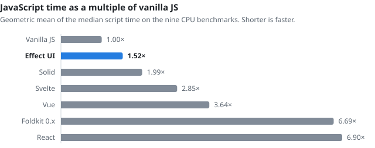
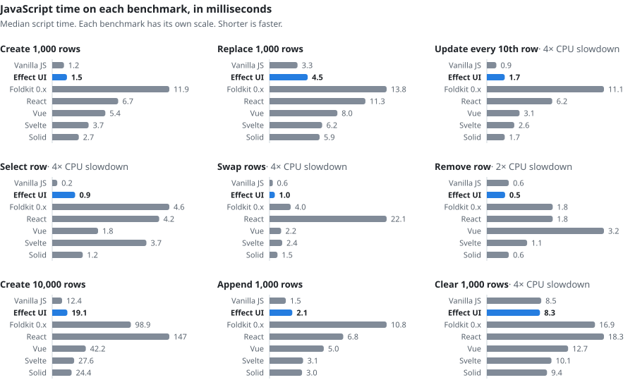
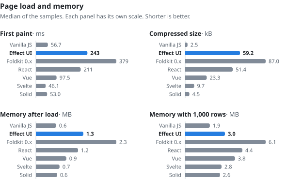

# js-framework-benchmark

Effect UI and Foldkit 0.x next to React, Vue, Svelte, Solid and vanilla JS on [krausest/js-framework-benchmark](https://github.com/krausest/js-framework-benchmark), the keyed table benchmark that most UI frameworks publish numbers for.

The harness already has entries for Foldkit and the other frameworks. `effect-ui/` is the entry for Effect UI. It isn't in the harness, and it doesn't need `@effect/ui` on npm: `run.sh` builds `packages/ui` from this checkout, packs it the way `pnpm publish` would, and installs the tarball. The version in the results is the commit.

## Results

Measured on 2026-11-27 with harness revision [`0f4e789`](https://github.com/krausest/js-framework-benchmark/tree/0f4e78932bf85ed60b163b801bbdbd720fdda54f), headless Chrome for Testing 156.0.8078.4, Node 26.13 and macOS 27.2, on an Apple M5 Pro (6 performance and 12 efficiency cores) with 64 GB of RAM. Effect UI is commit `6413803`.

This is one run of the harness's defaults: 15 iterations of each CPU benchmark (25 of select row) and one of each memory and size benchmark. It ran with `INTERLEAVE=1`: one benchmark at a time, each for all seven frameworks in turn, the order reversed from one benchmark to the next. Other jobs shared the machine, and its load average was between 7 and 23 during the run. The load average when each framework started each benchmark is in `results/interleaved/load.txt`. Earlier runs on this machine measured one framework at a time, and vanilla JS's times moved by 28% within minutes, so a busy stretch could fall on one framework's whole run.

Each cell is the median of the samples. Lower is better everywhere.

<picture>
  <source media="(prefers-color-scheme: dark)" srcset="charts/summary-dark.svg">
  
</picture>

<picture>
  <source media="(prefers-color-scheme: dark)" srcset="charts/script-dark.svg">
  
</picture>

<picture>
  <source media="(prefers-color-scheme: dark)" srcset="charts/load-dark.svg">
  
</picture>

| CPU, script (ms)      | vanillajs | effect-ui |  foldkit | react-hooks |      vue |   svelte |    solid |
| --------------------- | --------: | --------: | -------: | ----------: | -------: | -------: | -------: |
| create 1,000 rows     |       1.2 |       1.5 |     11.9 |         6.7 |      5.4 |      3.7 |      2.7 |
| replace 1,000 rows    |       3.3 |       4.5 |     13.8 |        11.3 |      8.0 |      6.2 |      5.9 |
| update every 10th row |       0.9 |       1.7 |     11.1 |         6.2 |      3.1 |      2.6 |      1.7 |
| select row            |       0.2 |       0.9 |      4.6 |         4.2 |      1.8 |      3.7 |      1.2 |
| swap rows             |       0.6 |       1.0 |      4.0 |        22.1 |      2.2 |      2.4 |      1.5 |
| remove row            |       0.6 |       0.5 |      1.8 |         1.8 |      3.2 |      1.1 |      0.6 |
| create 10,000 rows    |      12.4 |      19.1 |     98.9 |         147 |     42.2 |     27.6 |     24.4 |
| append 1,000 rows     |       1.5 |       2.1 |     10.8 |         6.8 |      5.0 |      3.1 |      3.0 |
| clear 1,000 rows      |       8.5 |       8.3 |     16.9 |        18.3 |     12.7 |     10.1 |      9.4 |
| **vs vanilla**        |  **1.00** |  **1.52** | **6.69** |    **6.90** | **3.64** | **2.85** | **1.99** |

| CPU, total (ms)       | vanillajs | effect-ui |  foldkit | react-hooks |      vue |   svelte |    solid |
| --------------------- | --------: | --------: | -------: | ----------: | -------: | -------: | -------: |
| create 1,000 rows     |      19.1 |      20.1 |     43.9 |        30.5 |     29.3 |     27.3 |     25.0 |
| replace 1,000 rows    |      24.3 |      26.5 |     43.7 |        33.4 |     29.8 |     28.2 |     28.4 |
| update every 10th row |      22.9 |      23.8 |     34.2 |        31.2 |     25.8 |     25.3 |     23.2 |
| select row            |       5.0 |       6.3 |     12.0 |        10.4 |      8.1 |     11.0 |      8.0 |
| swap rows             |      26.1 |      28.4 |     30.9 |         124 |     31.9 |     29.0 |     27.6 |
| remove row            |      15.0 |      16.1 |     18.7 |        21.1 |     22.0 |     19.7 |     18.6 |
| create 10,000 rows    |       210 |       265 |      401 |         420 |      306 |      273 |      257 |
| append 1,000 rows     |      28.5 |      30.3 |     43.2 |        31.8 |     32.0 |     28.2 |     27.9 |
| clear 1,000 rows      |      12.1 |      12.1 |     20.8 |        21.7 |     16.2 |     13.5 |     12.6 |
| **vs vanilla**        |  **1.00** |  **1.10** | **1.68** |    **1.77** | **1.34** | **1.27** | **1.17** |

| Memory and size           | vanillajs | effect-ui | foldkit | react-hooks |  vue | svelte | solid |
| ------------------------- | --------: | --------: | ------: | ----------: | ---: | -----: | ----: |
| ready memory (MB)         |       0.6 |       1.3 |     2.3 |         1.2 |  0.9 |    0.7 |   0.6 |
| run memory (MB)           |       1.9 |       3.0 |     6.1 |         4.4 |  3.8 |    2.8 |   2.6 |
| create/clear 5 times (MB) |       0.6 |       1.7 |     2.8 |         2.0 |  1.1 |    0.9 |   0.8 |
| uncompressed size (kB)    |      11.3 |       193 |     303 |         190 | 64.3 |   26.6 |  11.5 |
| compressed size (kB)      |       2.5 |      59.2 |    87.0 |        51.4 | 23.3 |    9.7 |   4.5 |
| first paint (ms)          |      56.7 |       243 |     379 |         211 | 97.5 |   46.1 |  53.0 |

`script` is the JavaScript that ran between the click and the end of the next paint, read from the Chrome trace. `total` is the whole of that time, most of it the browser's layout and paint. `vs vanilla` is the geometric mean, over the nine CPU benchmarks, of each framework's median over vanilla JS's. It's unweighted, unlike the harness's own result page, so vanilla JS's shortest times weigh as much as its longest: its select row took 0.2 ms in this run, which puts every framework at 4.5 to 23 times vanilla JS on that benchmark alone.

On this machine a benchmark's totals move by several milliseconds from one batch of iterations to the next, whatever the framework, so compare frameworks with the `script` table, and read the `total` table for magnitudes. Sizes and first paint are one sample each, so treat them as rough. The harness slows the CPU down 4 times for update every 10th row, select row, swap rows and clear 1,000 rows, and 2 times for remove row, so those rows of the tables are 4 (or 2) times what the same work takes at full speed.

## What the results say

In script time, Effect UI runs the least JavaScript of the six frameworks on eight of the nine benchmarks, and is level with Solid on the ninth, update every 10th row (1.7 ms each). Over the nine, it's 1.52 times vanilla JS, against 1.99 for Solid, 2.85 for Svelte and 3.64 for Vue. Its lead over Solid is widest on creating 1,000 rows (1.5 ms against 2.7 ms) and smallest on removing a row (0.5 ms against 0.6 ms) and clearing 1,000 rows (8.3 ms against 9.4 ms). A second run in the same session, of this commit and Solid alternating, had Solid ahead on update every 10th row (1.1 ms against 1.3 ms) and the two level on remove row, so read update every 10th row as level and remove row as close.

The entry renders each row with `Html.template`, which builds a row by copying the nodes it built for the first one and writing the values that differ, and lists the rows with `h.list`, which builds again only the rows whose item changed and tells the runtime which ones those are. That's where creating, appending and replacing get their lead. Small updates stay closer: each message still runs `update` and then the whole `view`, so updating every 10th row builds 100 rows' values and compares their slots, where Solid writes the 100 labels straight from the signals that changed.

In total time, Effect UI has the lowest figure over the nine in this run, 1.10 times vanilla JS, then Solid at 1.17, Svelte at 1.27 and Vue at 1.34. Those four are closer to each other than totals move between batches here. React and Foldkit 0.x are at 1.77 and 1.68.

Effect UI's bundle, 59.2 kB compressed, is larger than React's (51.4 kB) and smaller than Foldkit's (87.0 kB). Its first paint, 243 ms, is behind React's (211 ms) and well behind vanilla JS, Solid, Svelte and Vue (46 to 98 ms). After the page loads it holds 1.3 MB, about twice Solid's and Svelte's. With 1,000 rows it holds 3.0 MB, less than React (4.4 MB) and Vue (3.8 MB) and close to Svelte (2.8 MB) and Solid (2.6 MB). Against Foldkit 0.x, Effect UI runs a third of the JavaScript or less on eight of the nine benchmarks, and half on clearing rows (8.3 ms against 16.9 ms). It uses half the memory with 1,000 rows (3.0 MB against 6.1 MB).

## What the workloads measure

| Benchmark                        | What happens                                                               |
| -------------------------------- | -------------------------------------------------------------------------- |
| create 1,000 rows                | 1,000 rows into an empty table, after 5 warm-up runs                       |
| replace 1,000 rows               | 1,000 new rows over 1,000 existing ones                                    |
| update every 10th row            | the label of every 10th row of 1,000 gets `!!!` appended (16 warm-up runs) |
| select row                       | a click on a row's label highlights it                                     |
| swap rows                        | rows 2 and 999 of 1,000 swap places                                        |
| remove row                       | a click removes one of 1,000 rows                                          |
| create 10,000 rows               | 10,000 rows into an empty table                                            |
| append 1,000 rows                | 1,000 rows after 1,000 existing ones                                       |
| clear 1,000 rows                 | all 1,000 rows removed                                                     |
| ready memory                     | JS heap after the page loads                                               |
| run memory                       | JS heap after creating 1,000 rows                                          |
| create/clear 5 times             | JS heap after creating and clearing 1,000 rows 5 times                     |
| uncompressed and compressed size | the JavaScript the page loads                                              |
| first paint                      | from navigation to the first paint                                         |

Every entry renders the same DOM, and the harness checks that each one is keyed: a row's DOM node follows its data when rows move or are removed. The Effect UI entry renders each row with `Html.template` and lists the rows with `h.list`, so a row whose data and selection haven't changed isn't built again, as Foldkit's `createKeyedLazy` does for its entry. The page around the table is a template too, with the rows in the slot that is the `tbody`'s only child, so a message patches the rows and nothing else on the page.

## Versions

| Entry         | Package                | Version          |
| ------------- | ---------------------- | ---------------- |
| `effect-ui`   | `@effect/ui`, `effect` | `6413803`, 4.1.6 |
| `foldkit`     | `foldkit`, `effect`    | 0.171.0, 4.1.6   |
| `react-hooks` | `react`                | 19.2.0           |
| `vue`         | `vue`                  | 3.5.39           |
| `svelte`      | `svelte`               | 5.42.1           |
| `solid`       | `solid-js`             | 1.9.3            |
| `vanillajs`   |                        |                  |

The React, Vue, Svelte, Solid and vanilla JS entries are the harness's own, installed from its lockfiles. The Foldkit entry is the harness's too, moved from 0.170.0 to 0.171.0 and from Effect 4.1.0 to 4.1.6 so that both Effect frameworks use the same Effect.

## Reproducing

From the repository root, inside `nix develop` or on macOS, with Chromium on `PATH` or `$CHROMIUM` set. On macOS, the Chrome for Testing that Playwright installs works: `$CHROMIUM` is the `Google Chrome for Testing` binary inside its app bundle.

```sh
pnpm install
INTERLEAVE=1 packages/ui/benchmark/js-framework-benchmark/run.sh ../js-framework-benchmark
```

The argument is where the harness is cloned, outside this repository. `run.sh` clones the harness at the pinned revision with only the seven entries, installs it, builds and packs `@effect/ui`, builds every entry, starts the harness's server on port 8080, checks that every entry is keyed and runs the benchmarks. The results above are this command's, copied from `../js-framework-benchmark/webdriver-ts/results` to `results/interleaved`. It took 36 minutes here.

`INTERLEAVE=1` runs the harness's default benchmarks one at a time, each for every framework in turn, and reverses the order from one benchmark to the next, so that a busy stretch of a shared machine falls on every framework's runs of a benchmark within minutes. Without it, `run.sh` runs one framework at a time, and `REVERSE=1` runs the frameworks in reverse order. Arguments after the directory go to the harness, for example `--count 3 --benchmark 01_ 07_` for a quick check. With `INTERLEAVE=1`, the prefixes given with `--benchmark` are the benchmarks it runs in turn. Keep the default count when comparing frameworks: the harness starts a browser for each benchmark, and the first iteration in it is slower than the rest, most of all for the larger bundles, so a small count weighs that iteration more.

For a quicker comparison while working on a change, `quick.mjs` runs the CPU benchmarks in the harness's protocol against the harness's server, set up as above: a fresh page per sample, the harness's warm-up steps and CPU slowdowns, and the script time read from a trace of the measured click. The entries alternate sample by sample, so a change can be compared with the commit before it, or with another framework, in a few minutes:

```sh
node packages/ui/benchmark/js-framework-benchmark/quick.mjs --samples 11 solid effect-ui effect-ui:index-before.html
```

`effect-ui:index-before.html` is a copy of the entry's `index.html` that loads another build of it. Its figures are close to the harness's but not the same, so report the harness's.

To summarize one or more runs, and draw the charts above from them:

```sh
node packages/ui/benchmark/js-framework-benchmark/summarize.mjs \
  --charts packages/ui/benchmark/js-framework-benchmark/charts \
  packages/ui/benchmark/js-framework-benchmark/results/interleaved
```

## Files

| Path                  | What it is                                                                                                                                       |
| --------------------- | ------------------------------------------------------------------------------------------------------------------------------------------------ |
| `effect-ui/`          | the harness entry for Effect UI                                                                                                                  |
| `run.sh`              | sets up the harness and runs it                                                                                                                  |
| `quick.mjs`           | compares entries on the CPU benchmarks in the harness's protocol, in minutes                                                                     |
| `summarize.mjs`       | turns the harness's result files into the tables and charts above                                                                                |
| `charts/`             | the charts, in a light and a dark version each, drawn by `summarize.mjs --charts`                                                                |
| `results/interleaved` | the harness's raw result files from the run above, with every iteration's value, and the load average when each framework started each benchmark |
